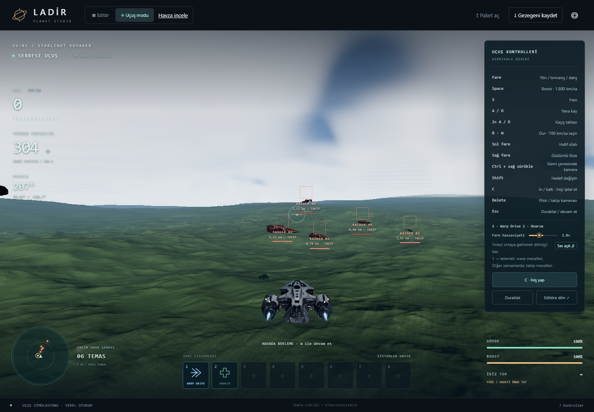

# LADİR — Yakın arazi yükleme araştırması ve uygulanan düzeltmeler

25 Ekim 2026 · Kaynak sürümü: 1.26.0 · Gezegen çapı: 8.000 km

## Sonuç

Gönderilen iki görüntü arasındaki bekleme, yalnızca kaplamanın geç gelmesi değil;
yakın arazinin daha yoğun geometrisinin üretilmesi, GPU'ya hazırlanması ve
komşularıyla birlikte görünür yapılmasıdır. Önce düz tepelerin, sonra küçük
vadilerin görünmesinin ana nedeni bu aşamalı geometri yüklemesidir.

Bu çalışmada kaynak kodu değiştirildi. Aynı kayıtlı dünyada tam ayrıntıya ulaşma
süresi ilk uçuş girişinde **16,2 saniyeden 12,3 saniyeye**, sıcak önbellekle
**14,5 saniyeden 10,8 saniyeye** indi. İlerleme var, fakat henüz anlık yükleme yok.

## Nasıl ölçüldü?

- Eski sürüm: değişikliklerden önce saklanan v1.25.0 üretim derlemesi.
- Yeni sürüm: aynı proje, v1.26.0 yükleme düzeltmeleri.
- Dünya: kullanıcının dışa aktarılan kaydı, kimlik başlangıcı `b7aefd351cef8c3f`.
- Konum: yaklaşık 59,43° K / 126,7° B; yön 207°; aynı kamera ayarı ve FOV.
- Donanım: NVIDIA GTX 1660 Ti; Chrome; 1440 × 1000 pencere; DPR 1.
- İlk giriş yeni tarayıcı bağlamında; ikinci giriş aynı bağlamda yeniden yükleme.
- Uçuş başladıktan sonra ileri hareket durduruldu; arazi hazır olma süresi ölçüldü.
- Aynı kalite varsayılanları kullanıldı. Bulutlar ve düşmanlar hareket etmeye devam
  ettiğinden görüntüler piksel piksel aynı kare değildir. Kaydın geçici editör
  görünüm ayarları, ekran görüntüsündeki bulutsuz hava dahil, bu testte taklit edilmedi.
- Kullanıcının açık 3B sekmesi ölçüm sırasında durduruldu. Başka uygulamalar ve
  işletim sistemi yükü bütünüyle kontrol edilemez. Her sürüm için tek soğuk/sıcak
  çift ölçüldü; sonuçlar evrensel hızlanma garantisi veya istatistiksel aralık değildir.

| Ölçüm | Eski | Yeni |
| --- | ---: | ---: |
| Sayfadan editör hazır olmasına, ilk giriş | 10,148 sn | 9,622 sn |
| Sayfadan editör hazır olmasına, tekrar giriş | 8,507 sn | 8,990 sn |
| Uçuş düğmesinden kokpit hazır olmasına, ilk giriş | 5,048 sn | 4,662 sn |
| Uçuş düğmesinden tam araziye, ilk giriş | 16,182 sn | 12,295 sn |
| Uçuş düğmesinden kokpit hazır olmasına, tekrar giriş | 4,588 sn | 2,210 sn |
| Uçuş düğmesinden tam araziye, tekrar giriş | 14,497 sn | 10,806 sn |

Tam arazi beklemesi bu çiftte yaklaşık **%24 / %25** kısaldı. Tekrar girişte
editör açılışı yaklaşık 0,5 saniye uzadı; bu ölçümde iyileşmeyen bölüm de budur.
Kokpit açılışı ile tam ayrıntı süresini toplayarak hesaplamayın: ikisi aynı uçuş
düğmesi anından ölçülür. Sayfa açılışı bunlardan ayrı bir aşamadır.

## Uzun beklemenin doğrulanan nedenleri

### 1. Kalıcı önbellek geç açılınca devre dışı kalıyordu

IndexedDB 250 ms içinde yanıt vermeyince eski kod o Worker'ın oturumu boyunca
önbelleği kapatıyordu. Yoğun açılışta bu süre kolayca aşılabiliyor. Eski ölçümde
hem ilk hem ikinci girişte mesh önbelleği isabet sayısı **sıfırdı**.

Düzeltme: süre dolunca mevcut üretici çalışmaya devam ediyor; bağlantı sonradan
başarılı açılırsa saklanıyor ve sonraki okuma/yazmalar kullanabiliyor. Yeni sıcak
ölçümde **1.423 parça** hazır geometri önbelleğinden geldi. 36 okuma zaman aşımı
kaldı; bu parçalar üreticiye döndü. Veri kaybı veya bekleyen sonsuz yükleme yok.

### 2. İlk yakın yüzey tekrar tekrar üretiliyordu

8 hücreli yakın önizleme parçaları kalıcı önbelleğe alınmıyordu. Artık bunlar da
ayrıntılı parçalarla aynı bayt bütçesini kullanıyor. Disk sınırı 128 MiB, Worker
yazma kuyruğu 2 MiB olarak korundu. 6 kayıt yerine 24 kayıtlık sınırlı yazma
grupları, işlem başlatma maliyetini azaltıyor. Kota ve hata halinde üreticiye
güvenli dönüş korunuyor.

### 3. LOD seçimi de yükseklik hesabı yapıyor

Hangi parçanın gerekli olduğunu bulurken arazi yeniden örnekleniyordu.
LOD planlayıcısına sınırlı bir örnek önbelleği eklendi. Aynı girdinin aynı parça
listesini verdiği test edildi. Bu, yükseklikleri veya detay eşiğini değiştirmiyor.

### 4. Hazır geometri varken kaynak yükseklik tile'ı okunabiliyordu

Patch Worker artık önce tam kimlikli mesh önbelleğini arıyor. Geometri zaten
hazırsa bölgesel kaynak verisini tekrar okuyup açmıyor. Bulunmayan veya geçersiz
veri için mevcut kanonik üretim yolu devam ediyor.

### 5. Komşuların hazır olma zorunluluğu yakın parçaları bekletiyor

Kullanıcının bölgesinde **846 parçalık bir bağlı geçiş grubu** görüldü. Bazı yakın
parçalar hazır olsa bile komşu kenarlar tamamlanmadan grubun gösterilmesi çatlak
üretebilir. Bu nedenle yalnızca “en yakın parçayı hemen göster” değişikliği
güvenli bir çözüm değil. Mevcut kesintisiz yüzey bekleme boyunca korunuyor.

GPU hazırlığı ile geçiş uygulaması ortak CPU süresine bölündü. Aktarım ucuzsa ve
GPU kuyruğu rahat ise mevcut üst sınır olan 288 KiB kullanılabiliyor. Tek bir
bağlı geçiş grubu bölünmüyor; zaman bütçesini aşarsa ölçüme yazılıyor.

## Hazır geometri paketi denemesi

Referans kayıtlı dünya için yükseklik, normal, materyal ve su kanallarını koruyan
tam mesh paketleri üretildi. Dünya kimliği, 4.000.000 m yarıçap, üretici/build
sürümü, bölgesel yüzey profili ve kenar örnekleri kontrol ediliyor. İmza veya
dosya hatası olduğunda mevcut üretici çalışıyor.

- 7.524 tam parça, 49 sıkıştırılmış paket.
- Sıkıştırılmış veri: 46.721.591 bayt; ayrıca 3.915.157 baytlık indeks.
- Paket başına en fazla 2 MiB açılmış veri; Worker başına en fazla 4 MiB tutulan
  paket verisi. Üç Worker'ın toplamı ve geçici açma tamponları ayrıca hesaplanmalıdır.
- Büyük indeks uygulama paketine gömülmüyor; yalnız eşleşen dünya gerektiğinde okuyor.
- Tarayıcı denemesinde 2.427 parça statik paketten alındı; önbellek hatası sıfırdı.

Bu paket kullanıcının ölçülen `b7aefd…` dünyasıyla aynı dünya değildir. Kullanıcı
bölgesinin yukarıdaki kazanımı, bu paketten değil çalışma anı önbellek/planlama
düzeltmelerinden gelir. Paket, bütün gezegenin veya her kamera/LOD kenar
kombinasyonunun önceden hazır olduğunu göstermez.

Üretim komutu:

```sh
npm run bake:startup
npm run build
```

Komut varsayılan olarak `fixtures/lumen-v35.planet` dünyasını kullanır. Başka bir
kayıt yolu verilebilir; mevcut prototip doğrulanmış bölgesel yüzey profili olan
dünya ister ve tek dünya kataloğu yazar. Birden fazla dünya kataloğunu otomatik
birleştirmez. Geometri kaynakları değişirse kaba paketler için
`npm run bake:terrain` de çalıştırılmalıdır.

## Beklemeyi çok daha kısa yapmak için önerilen sıra

| Sıra | İş | Neyi azaltır? | Neden hemen basit bir ayar değil? |
| --- | --- | --- | --- |
| 1 | Kamera açısından bağımsız, çok seviyeli yükseklik/materyal tile'ları | Aynı bölgenin farklı LOD kenarları için tekrar üretilmesi | CPU çarpışma, su ve ağaç kökleri aynı yüzeyi kullanmalı |
| 2 | Kararlı geçiş kenarları veya doğrulanmış morph ile küçük görünür gruplar | Hazır yakın parçanın yüzlerce komşuyu beklemesi | Mevcut grubu doğrudan bölmek eski çatlakları geri getirir |
| 3 | Başlangıç ve varış bölgesini önceden üretme/yükleme | İlk uçuş ve warp varışındaki hesap | Bütün gezegen tek dosya yapılmamalı; hedef konum ve bayt bütçesi gerekli |
| 4 | Disk okuma/yazma çekişmesini ayırma; LOD başına üretimi profilleme | Sıcak önbellekteki zaman aşımları ve kalan hesap | Yalnız Worker sayısını artırmak disk/GPU kuyruğunu büyütebilir |

İlk iki iş birlikte, görünen beklemeyi 1–2 saniye hedefine yaklaştırmak için en
güçlü adaydır. **Bu süre henüz ölçülmüş bir sonuç değildir.** WebGPU, WASM,
ortak GPU gridleri ve warp ön yüklemesi zaten kullanılıyor; yalnız bu teknoloji
adlarını eklemek kalan maliyeti ortadan kaldırmaz.

## Görüntü ve bellek kontrolü

Eski ve yeni tam görüntüde 1.386 aktif arazi parçası vardı. Takip edilen terrain
CPU tamponları yaklaşık 142,4 MB ve 142,7 MB idi. Bu sayılar bütün tarayıcı RAM'i,
Worker heap'i veya ekran kartının toplam VRAM'i değildir.




Yakın detay, DPR, ağaç yoğunluğu, efektler veya görüş mesafesi azaltılmadı.
Fiziksel ölçek ve 8.000 km çap korundu. Bir fotoğraf çatlaksız görünse bile
bütün olası uçuş rotalarının kusursuz olduğunu kanıtlamaz; kenar ve warp
regresyon testleri de çalıştırıldı.

## Uçuş akıcılığı ayrıca kontrol edildi

Ayrı referans dünyada aynı kayıtlı 60 saniyelik rota iki sürümde de ilk ve
sıcak tur olarak çalıştırıldı. Orman, göl, nehir, kanyon, boost bırakma,
çatışma, kısa/uzun warp, küp yüzü sınırı ve kutup senaryoları dahil edildi.
Senaryolar arası test yer değiştirmeleri de ölçüme dahildir.

| Tur | CPU p95 | GPU render p95 | Kare aralığı p99 | En uzun aralık | 100 ms üstü |
| --- | ---: | ---: | ---: | ---: | ---: |
| Eski ilk tur | 12,24 ms | 7,14 ms | 33,35 ms | 233,25 ms | 1 |
| Yeni ilk tur | 9,33 ms | 5,93 ms | 17,13 ms | 266,51 ms | 3 |
| Eski sıcak tur | 7,96 ms | 6,80 ms | 17,09 ms | 116,67 ms | 1 |
| Yeni sıcak tur | 8,28 ms | 7,93 ms | 17,08 ms | 166,49 ms | 3 |

İlk turun p99 değeri iyileşti, fakat **en uzun takılmalar azalmadı**. Yeni
ölçümde en uzun duraklama ilk orman ayrıntılanmasında, bir diğeri kısa warp
sırasında görüldü. Bağlı geçiş uygulaması 19,8 ms'ye ulaşabildi. Bu kalan sorunu
başarılı bir FPS optimizasyonu gibi saymıyorum.

60 Hz/headless ölçümünde çizim yaklaşık 58–59 FPS kaldı. Bu, 100 Hz sunum testi
değildir. GPU zaman damgası çizim işini ölçer; sıra beklemesini ve tarayıcının
diğer işlerini bütünüyle içermez. CPU ve GPU p95 değerlerini toplayıp toplam
kare süresi diye yorumlamak da doğru değildir. **100 FPS hedefi doğrulanmadı.**

Ölçülen ana thread JS heap tepe değerleri eski ilk/sıcak turda 415/409 MB,
yeni turda 461/380 MB; takip edilen GPU tamponları eski 135 MB, yeni 120/122 MB.
Worker RAM'i ve GPU doku/sürücü belleği bu sayılara tam olarak dahil değildir.
Kısa rotalar uzun oturumda bellek sızıntısı olmadığını kanıtlamaz.

Ham uçuş kayıtları: [eski](../../evidence/v41/flight-before/benchmark.json),
[yeni](../../evidence/v41/flight-final/benchmark.json).

## Doğrulama

- Mevcut 215 testin 213'ü ilk çalıştırmada geçti. İki sunucu testi sandbox'ın
  alt süreç engeline takıldı; izinli süreçte tekrar çalıştırılınca ikisi de geçti.
- Eklenen kontroller dahil son terrain/streaming/warp/pool grubu: **41/41 geçti**.
- Kilit dosyası, belge bağlantıları ve WASM kaynak/binary kimliği kontrolü geçti.
- Üretim derlemesi geçti. NVIDIA donanımında editör/uçuş geçişi ve **154 shader
  modülü** doğrulandı; shader/cihaz kaybı hatası saptanmadı.
- Sonuçlar yalnız çalıştırılan kontroller için geçerlidir. Yeni GitHub CI
  çalışması bu yerel doğrulamanın yerine geçmiş gibi gösterilmemiştir.

[Doğrulama kaydı](../../evidence/v41/validation.json)

## Kaynaklar

- [Cesium 3D Tileset](https://cesium.com/learn/cesiumjs/ref-doc/Cesium3DTileset.html):
  görünür tile önceliği, varış ön yüklemesi, aşamalı çözünürlük ve bayt bütçesi.
  Cesium projeye eklenmedi; yaklaşım araştırma referansıdır.
- [Three.js Renderer](https://threejs.org/docs/pages/Renderer): ilk kullanımda
  shader ve doku hazırlığı. Var olan ön derleme yaklaşımı korundu.
- [web.dev — Uzun işleri optimize etme](https://web.dev/articles/optimize-long-tasks):
  işi bölmek kilitlenmeyi azaltır, toplam hesap miktarını tek başına azaltmaz.

Kod ayrıntıları ve tekrarlama yöntemi:
[Streaming performance](../../docs/STREAMING_PERFORMANCE.md).
Ham kayıtlar: [eski](../../evidence/v41/user-before/loading.json),
[yeni](../../evidence/v41/user-final/loading.json).
