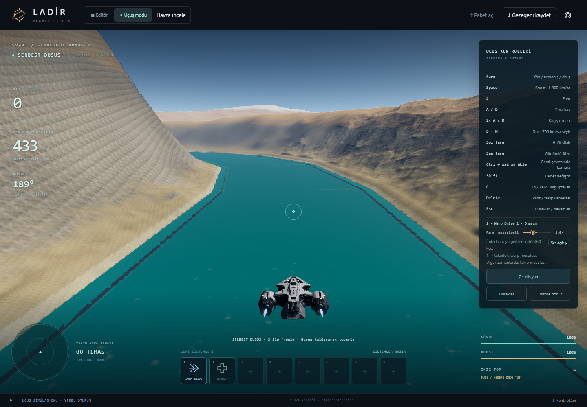
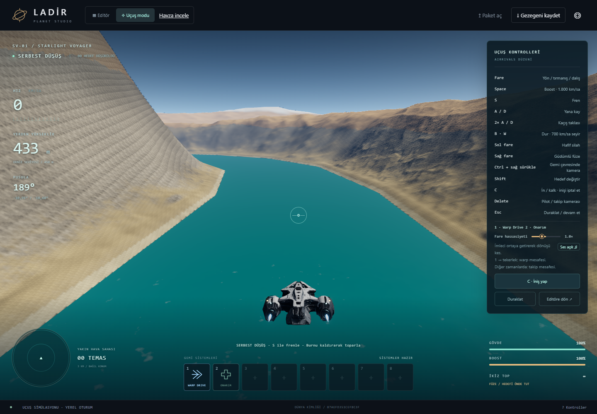

# LADİR V42 / v1.26.1 — Nehir kıyısı ve alçalma

## Uygulanan düzeltmeler

Nehir kıyısındaki boşluk yeniden üretildi ve kaynak kodunda düzeltildi. Deniz
seviyesindeki nehirler, ayrı bir nehir etiketi taşıdıkları için deniz geometrisinden
çıkarılıyor; daha dar bir su şeridi aradaki alanı kapatmıyordu. Bu iki yüzey artık
ortak deniz kotunda birleşiyor. Yüksekteki nehirler kendi azalan su kotlarını koruyor.

İç kesimlerdeki nehir şeritleri bütün genişlikleriyle tile sınırına kırpılıyor.
Virajlarda komşu parçalar aynı kıyı köşesini paylaşıyor. Küp yüzü geçişinde su kotu
perspektif düzeltmesiyle hesaplanıyor; kenar testi 1 cm altındaki eşleşmeyi denetliyor.

Alçalma için mevcut kameranın yanında gelecekteki görüş hacmi de hazırlanıyor.
Ön yükleme en fazla 6 saniye / 4 km; normal uçuşta 2,4 saniye / 1,5 km. Beklenen
rota üzerinde ilerlemek artık o rotanın işlerini iptal etmiyor. Araziyi bitiren
komşu kenarlar, ilgisiz uzak parçalardan önce üretiliyor. Geçerli parent yüzey
yeni parçalar hazır olana kadar korunuyor.

8 km yaklaşma bandında bazı gridlerin 16 hücreden 8 hücreye dönmesi kaldırıldı.
Alçalırken yakın ayak izindeki mevcut ayrıntı korunuyor. Kenarı gerçekten aynı
kalan geçişler bağımsız yayımlanabiliyor; değişen ortak kenarlar birlikte geçiyor.
DPR, efektler, ağaç yoğunluğu ve GPU aktarımının bayt sınırları azaltılmadı.

Dünya yarıçapı **4.000.000 metre**, çapı **8.000 km**. Kayıt, seed, fiziksel
yer şekilleri ve uçuş fiziği değiştirilmedi. Mesh bake paketleri yeni geometri
imzasıyla yeniden üretildi; eski önbellek bu düzeltmeyi geri alamıyor.

## Önce / sonra

İki görüntü aynı kayıt, aynı rota, aynı kamera ve aynı görünüm ayarlarından alındı.

Önce:



Sonra:



## Ölçüm yöntemi

`fixtures/river-v42.planet` kullanıldı. Dünya kimliği:
`b7aefd351cef8c3f6e23e5878c5369987fa41d29e28a4fe9297c891ad09efada`.

Chrome / NVIDIA Turing, 1440 × 1000 pencere, varsayılan render kalitesi. Aynı
nehirde deniz seviyesinden 8.500 m yükseklikten 450 m'ye 650 m/s ile programlı
alçalma yapıldı. Hareket yaklaşık **12,38 saniye** sürüyor. İlk tur o bölgede
soğuk yükleme; ikinci tur aynı tarayıcı bağlamında RAM/disk önbelleğiyle tekrar.

Ekran görüntüleri zamanlanan aralığın dışında alındı. Ölçümler birer soğuk/sıcak
çiftinden oluşuyor; farklı cihazlara genellenemez. Diğer uygulamalar bütünüyle
izole edilmedi. CPU süreleri çizim gönderimini içerir; bu testte GPU timestamp
süresi ölçülmedi. Ekran yenileme sınırı ve CPU/GPU işleme maliyeti aynı şey değildir.

## Ölçülen sonuçlar

Değer sırası **soğuk / sıcak**. Kamera FOV'u her iki sürümde **64°**.

| Ölçüt | v1.26.0 | v1.26.1 |
|---|---:|---:|
| Yakın referans noktasında eski 3,81 m/hücre ayrıntısının ilk görünmesi | 16,51 sn / 16,24 sn | 11,30 sn / 8,60 sn |
| Alçalma bittikten sonra aynı ayrıntıyı bekleme | 4,13 sn / 3,85 sn | 0,00 sn / 0,00 sn |
| Tüm seçili arazi kuyruğunun bitişi | 16,59 sn / 16,24 sn | 21,53 sn / 17,08 sn |
| Alçalma sırasında iptal edilen plan | 4 / 5 | 0 / 0 |
| En büyük birlikte bekleyen parça grubu | 510 / 569 | 366 / 319 |
| CPU çizim gönderimi p95 | 8,47 ms / 7,40 ms | 8,43 ms / 9,06 ms |
| Kare aralığı p99 | 49,92 ms / 33,25 ms | 49,99 ms / 50,05 ms |
| En uzun kare aralığı | 299,84 ms / 183,51 ms | 149,97 ms / 99,81 ms |
| 100 ms üzerindeki kare sayısı | 3 / 1 | 1 / 0 |
| İzlenen arazi buffer belleği tepe değeri | 163,0 MiB / 185,4 MiB | 204,0 MiB / 201,7 MiB |

Kamera altındaki referans noktası eski ayrıntı eşiğine soğuk turda yaklaşık
**5,21 saniye**, sıcak turda **7,64 saniye daha erken** ulaştı. Bu noktada
yüzeye yaklaşma bittikten sonra bekleme kalmadı. Bu sonuç bütün ekranın veya
bütün gezegenin aynı anda tam ayrıntıya ulaştığı anlamına gelmez.

**Toplam yükleme süresi azalmadı.** Önden hazırlanan ek ayrıntılar nedeniyle
tüm kuyruğun bitmesi soğuk turda 16,59'dan 21,53 saniyeye; sıcak turda 16,24'ten
17,08 saniyeye çıktı. Yeni soğuk turun son örneği 0,95 m/hücre, sıcak turun
son örneği 3,81 m/hücreydi; önceki sürüm iki turda da 3,81 m/hücreydi.
Bu yüzden yalnız tam kuyruk bitişinden bir hızlanma oranı çıkarmak doğru değil.

Alçalma boyunca izlenen referans noktada yeni sürümde ayrıntı geri gitmedi.
Sıcak turda hareket bittikten sonra öngörü için tutulan 1,91 m/hücre grid,
normal ekran hatası hedefi olan 3,81 m/hücreye döndü. Ön yükleme de daha fazla
bellek kullanıyor; tablodaki sayı yalnız izlenen arazi bufferlarını kapsar,
tüm sekmenin RAM'i veya ekran kartının VRAM'i değildir.

Nehir testi, hazır açılış mesh paketiyle eşleşmeyen B7AE… dünyasında yapıldı.
Burada prosedürel üretim ve çalışma anında doldurulan cache kullanılıyor.
Yenilenen hazır açılış paketleri standart 595A… dünyasına ait; bu test için
paketten anlık yükleme başarısı iddia edilmiyor.

## Doğrulama ve kalan işler

- Son kaynak koduyla tam test çalıştırması: **228/228 geçti**, atlanan test yok.
  Toplam test süresi 151,2 saniye.
- Bake paketleri yeniden üretildi; sürüm ve dünya ayrımı korunuyor.
- Gerçek WebGPU smoke testi geçti: 154 shader modülü; editör, uçuş, warp ve
  onarım kontrolleri. Tarayıcı karşılaştırmalarında kaydedilen hata yok.
- Kıyı boşluğu aynı kameradan önce/sonra görüntüleriyle doğrulandı.
- Uzun kareler tamamen kalkmadı; p99 kare aralığı da iyileşmiş sayılmaz.
  **100 FPS doğrulanmış değil.** Bu koşuda GPU süreleri ayrı ölçülmedi.
- Sonraki darboğaz: tüm öngörü kuyruğunun bitişi ve ek ayrıntının bellek maliyeti.
  Kameraya gereken ayrıntı daha erken geliyor, fakat uzak/ek ayrıntı hâlâ arkadan
  tamamlanıyor. Daha düşük toplam yük için öngörü verisini ve geçiş gruplarını
  daha küçük bağımsız paketlere ayırmak ayrıca ölçülmeli.


## İki kamera önerisi

Arazi ve hareketli nesneleri katmanlara ayırmak mümkün. Konum, dönüş, FOV,
floating origin ve derinlik aynı kareyi temsil etmelidir. Ancak ikinci kamera,
Worker'ın eksik arazi geometrisini üretme süresini kısaltmaz. Kamera hareket
ettiğinde arazi görüntüsü de değişir; eski görüntüyü kullanmak ayrıca derinlik
ile yeniden yansıtma ve yeni açılan alanları doldurma gerektirir.

Bu sürüm ortak kamera/derinlik düzenini ve mevcut ayrı yarım çözünürlüklü atmosfer
geçişini koruyor. İkinci tam sahne çizimi eklenmedi. Bu, kaynak akışından yapılan
bir mimari değerlendirmedir; iki kamera için ölçülmüş FPS kazancı iddia edilmiyor.
[Three.js katmanları](https://threejs.org/docs/pages/Layers.html),
[derinlik kontrolleri](https://threejs.org/docs/pages/Renderer.html),
[render geçişleri](https://threejs.org/docs/pages/RenderPipeline.html).

## Kod ve yeniden çalıştırma

- `render/water-clip.mjs`, `render/terrain-data.mjs`: su birleşimi, kırpma ve yaklaşma LOD'si.
- `render/stream-plan.mjs`, `render/terrain-stream.mjs`, `workers/lod.mjs`: kenar bağımlılıkları, öncelik ve öngörü.
- `io/terrain-bake-build.mjs`, `io/baked-worlds.mjs`, `io/startup-bakes.mjs`, `assets/terrain-bakes/`: sürümlü paketler.
- `tests/shore-streaming.test.mjs`, `tests/lod.test.mjs`, `tests/warp-streaming.test.mjs`: yeni regresyon kontrolleri.
- `scripts/benchmark-descent.mjs`, `fixtures/river-v42.planet`: tekrar üretilebilir karşılaştırma.

```sh
npm run bake:terrain
npm run bake:startup
npm run build
npm test
npm run check
node scripts/serve.mjs
# Ayrı terminalde:
node scripts/benchmark-descent.mjs
```

Ham kayıtlar: [eski sürüm](../../evidence/v42/baseline/descent.json),
[yeni sürüm](../../evidence/v42/release/descent.json).
